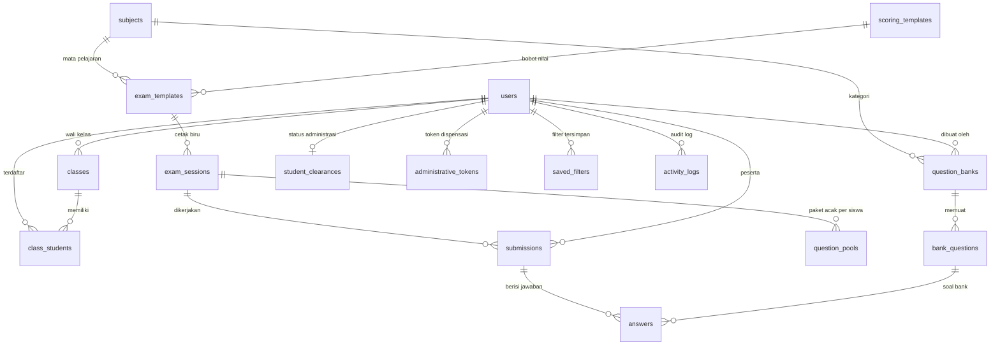

# 🗄️ Dokumentasi Skema Database CartaExam

Dokumentasi lengkap arsitektur basis data **CartaExam**. Basis data dirancang secara agnostik menggunakan **Drizzle ORM** yang mendukung 3 provider database utama:
- **SQLite** (`src/lib/schemas/sqlite.ts`) — Ideal untuk instalasi cepat, uji coba, dan sekolah kecil-menengah.
- **MySQL / MariaDB** (`src/lib/schemas/mysql.ts`) — Direkomendasikan untuk produksi skala besar.
- **PostgreSQL** (`src/lib/schemas/postgresql.ts`) — Alternatif enterprise.

Seluruh skema diekspor secara dinamis berdasarkan variabel lingkungan `DB_TYPE` melalui [`src/lib/schema.ts`](../src/lib/schema.ts) dan dikoneksikan melalui [`src/lib/db.ts`](../src/lib/db.ts).

---

## 🏗️ Diagram Relasi Entitas (ERD)



---

## 📑 Daftar Lengkap 20 Tabel

### 1. Entitas Inti & Akademik

#### `users`
Menyimpan akun seluruh pengguna (`admin`, `teacher`, `student`).
| Kolom | Tipe | Keterangan |
|---|---|---|
| `id` | `text` / `varchar(36)` (PK) | UUID v4 otomatis |
| `name` | `text` | Nama lengkap pengguna |
| `username` | `text` (Unique) | Username / NIS / NISN / NIP untuk login |
| `password` | `text` | Hash password **bcrypt** |
| `role` | `enum` | `admin` \| `teacher` \| `student` |
| `created_at` | `timestamp` | Waktu pembuatan akun |

#### `subjects`
Daftar mata pelajaran sekolah.
- `id` (PK), `name`, `code` (Unique, mis. `MAT`, `BIN`), `description`, `created_at`.

#### `classes`
Rombongan belajar / kelas.
- `id` (PK), `name` (mis. `X-1`, `XI IPA 2`), `grade` (`10` \| `11` \| `12`), `academic_year` (mis. `2026/2027`), `teacher_id` (FK `users.id`, nullable, wali kelas), `created_at`.

#### `class_students`
Tabel relasi penempatan siswa ke dalam kelas.
- `id` (PK), `class_id` (FK `classes.id` cascade), `student_id` (FK `users.id` cascade), `enrolled_at`.

---

### 2. Bank Soal & Pembobotan

#### `question_banks`
Koleksi soal per mata pelajaran dan pembuat.
- `id` (PK), `subject_id` (FK `subjects.id` cascade), `name`, `description`, `created_by` (FK `users.id` set null), `created_at`, `updated_at`.

#### `bank_questions`
Butir soal detail dengan 6 tipe standar.
| Kolom | Tipe | Keterangan |
|---|---|---|
| `id` | `text` (PK) | UUID soal |
| `bank_id` | `text` (FK) | Referensi ke `question_banks.id` |
| `type` | `enum` | `mc` \| `complex_mc` \| `matching` \| `short` \| `essay` \| `true_false` |
| `content` | `json` | Struktur konten soal (HTML + LaTeX KaTeX + opsi/pasangan) |
| `answer_key` | `json` | Kunci jawaban, poin, rubrik esai, atau `acceptedAnswers` |
| `tags` | `json` | Array tag topik/bab (mis. `["Trigonometri", "HOTS"]`) |
| `difficulty` | `enum` | `easy` \| `medium` \| `hard` |
| `default_points` | `integer` | Bobot poin default (default `1`) |
| `question_number` | `integer` | Nomor urut soal dalam bank |
| `metadata` | `json` | Metadata tambahan (pembahasan/explanation, impor DOCX, dll.) |
| `created_by`, `created_at`, `updated_at`, `last_used` | `text` / `timestamp` | Audit & pelacakan penggunaan |

#### `scoring_templates`
Template bobot nilai dan aturan *partial credit* yang dapat digunakan ulang.
- `id` (PK), `name`, `description`, `default_weights` (JSON `{ mc, complex_mc, matching, short, essay, true_false }`), `allow_partial_credit` (boolean), `partial_credit_rules` (JSON `{ complex_mc?, matching? }`), `created_at`.

---

### 3. Template, Sesi Ujian & Pengacakan

#### `exam_templates`
Cetak biru (*blueprint*) ujian.
| Kolom | Tipe | Keterangan |
|---|---|---|
| `id`, `name`, `description`, `subject_id` | `text` | Identitas & mapel ujian |
| `bank_ids`, `filter_tags`, `question_composition` | `json` | Daftar bank sumber & jumlah soal per tipe |
| `use_question_pool`, `pool_size` | `boolean`, `integer` | Opsi penarikan acak subset soal dari pool |
| `scoring_template_id`, `custom_weights`, `total_score` | `text`, `json`, `integer` | Konfigurasi penilaian & skala nilai (default `100`) |
| `duration_minutes`, `min_duration_minutes` | `integer` | Durasi ujian & batas waktu minimal sebelum submit |
| `randomize_questions`, `randomize_answers`, `essay_at_end` | `boolean` | Pengacakan soal, opsi jawaban, dan posisi esai di akhir |
| `randomization_rules` | `json` | `{ mode: 'all' \| 'by_type' \| 'exclude_type' \| 'specific_numbers', types?, excludeTypes?, questionNumbers? }` |
| `target_type`, `target_ids` | `text`, `json` | Target peserta default (`all` \| `classes` \| `grades` \| `students`) |
| `enable_lockdown`, `require_token`, `max_violations`, `max_tab_switches` | `boolean`, `integer` | Pengaturan keamanan dasar |
| `violation_settings` | `json` | Pengaturan detail lockdown (lihat struktur di bawah) |
| `allow_review`, `show_result_immediately`, `allow_retake` | `boolean` | Hak tinjau hasil dan ulang ujian siswa |
| `display_settings` | `json` | `{ showQuestionNumber, showRemainingTime, showNavigation }` |
| `created_by`, `created_at`, `updated_at` | `text`, `timestamp` | Kepemilikan & timestamp |

**Struktur JSON `violation_settings`:**
```json
{
  "detectTabSwitch": true,
  "detectCopyPaste": true,
  "detectRightClick": true,
  "detectScreenshot": true,
  "detectDevTools": true,
  "cooldownSeconds": 5,
  "mode": "strict",
  "deviceBinding": false,
  "requireSeb": true,
  "requireExambro": true,
  "watermarkAntiTamper": true,
  "maxAwaySeconds": 15,
  "lateToleranceMinutes": 10,
  "exambroScreenshotCapture": {
    "enabled": true,
    "burstCount": 3,
    "firstDelayMs": 0,
    "followUpIntervalSeconds": 2,
    "targetTypes": ["APP_SWITCH", "WINDOW_BLUR", "SPLIT_SCREEN", "PIP_MODE", "OVERLAY_DETECTED"]
  }
}
```

#### `exam_sessions`
Jadwal pelaksanaan ujian aktif berdasarkan template.
- `id` (PK), `template_id` (FK `exam_templates.id` cascade), `session_name`, `start_time`, `end_time`, `status` (`scheduled` \| `active` \| `completed` \| `cancelled`), `access_token` (token proktor opsional), `target_type` (`class` \| `individual`), `target_ids` (JSON array ID kelas atau siswa), `generated_questions` (JSON map `{ studentId: questionIds[] }`), `created_by`, `created_at`.

#### `question_pools`
Menyimpan alokasi soal terurut per siswa untuk sesi yang di-generate.
- `id` (PK), `session_id` (FK `exam_sessions.id`), `student_id` (FK `users.id`), `selected_questions` (JSON), `question_order` (JSON), `generated_at`.

---

### 4. Pengerjaan & Penilaian Ujian

#### `submissions`
Lembar pengerjaan ujian siswa per sesi.
| Kolom | Tipe | Keterangan |
|---|---|---|
| `id` | `text` (PK) | UUID submission |
| `exam_id` | `text` (FK, nullable) | Kompatibilitas tabel legacy `exams` |
| `user_id` | `text` (FK `users.id`) | ID siswa |
| `session_id` | `text` (FK `exam_sessions.id`) | ID sesi ujian |
| `score`, `total_points`, `earned_points` | `integer` | Skor skala (0–100) & poin mentah |
| `start_time`, `end_time`, `bonus_time_minutes` | `timestamp`, `integer` | Waktu mulai, selesai, dan tambahan waktu dari pengawas |
| `question_order`, `flagged_questions` | `json` | Urutan ID soal siswa & daftar soal bertanda ragu-ragu |
| `violation_count`, `violation_log` | `integer`, `json` | Jumlah & log pelanggaran (`{ id, type, details, timestamp, evidenceUrl, evidenceUrls }`) |
| `device_id` | `text` | Identifier unik perangkat untuk fitur *Device Binding* |
| `status` | `enum` | `in_progress` \| `completed` \| `terminated` |
| `grading_status` | `enum` | `auto` \| `pending_manual` \| `manual` \| `completed` \| `published` |
| `created_at` | `timestamp` | Timestamp pembuatan |

#### `answers`
Jawaban per butir soal dalam satu submission.
- `id` (PK), `submission_id` (FK `submissions.id` cascade), `question_id` (legacy, nullable), `bank_question_id` (FK `bank_questions.id` cascade), `student_answer` (JSON), `is_flagged` (boolean), `is_correct` (boolean), `score`, `max_points`, `partial_points`, `grading_status` (`auto` \| `pending_manual` \| `manual` \| `completed`), `graded_by` (FK `users.id`), `graded_at`, `grading_notes`.

---

### 5. Administrasi Siswa & Dispensasi Ujian

#### `student_clearances`
Status kelayakan administratif peserta ujian (misalnya oleh Tata Usaha / Keuangan).
- `id` (PK), `student_id` (FK `users.id` cascade), `status` (`locked` \| `cleared` \| `dispensation`), `notes`, `valid_until` (timestamp batas akhir dispensasi — otomatis kembali terkunci jika lewat), `updated_by` (FK `users.id`), `updated_at`.

#### `administrative_tokens`
Token sekali pakai (*one-time bypass*) yang diterbitkan Tata Usaha bagi siswa yang berstatus `locked`.
- `id` (PK), `token` (Unique, mis. 6 karakter alfanumerik), `scope` (`session` \| `daily` \| `weekly` \| `permanent`), `student_id` (FK `users.id` cascade, opsional/spesifik siswa), `expires_at`, `is_used` (boolean), `used_at`, `notes`, `created_by`, `created_at`.

---

### 6. Pengaturan Sekolah, Preferensi & Audit

#### `school_settings`
Konfigurasi global identitas sekolah, landing page, dan AI provider.
- `id` (PK), `school_name`, `school_description`, `logo_url`, `html_title`, `favicon_url`, `hero_title`, `hero_description`, `hero_show_stats`, `features_title`, `features_subtitle`, `features` (JSON), `footer_text`, `contact_email`, `contact_phone`, `address`, `announcement_title` (MySQL/SQLite), `announcement_content` (MySQL/SQLite), `ai_config` (JSON `{ provider, geminiApiKey, geminiModel, openrouterApiKey, openrouterModel, openaiApiKey, openaiBaseUrl, openaiModel }`), `updated_by`, `updated_at`.

#### `saved_filters`
Preset filter tersimpan milik masing-masing guru/admin (halaman penilaian, sesi, bank soal).
- `id` (PK), `user_id` (FK `users.id` cascade), `name`, `page`, `filters` (JSON), `is_default` (boolean), `created_at`.

#### `activity_logs`
Rekam jejak audit seluruh aksi penting sistem.
- `id` (PK), `user_id` (FK `users.id` set null), `action`, `entity_type`, `entity_id`, `details` (JSON), `created_at`.

---

### 7. Tabel Legacy (Kompatibilitas Mundur)
- `exams`, `questions`, `exam_tokens`: dipertahankan untuk kompatibilitas migrasi awal; alur ujian modern sepenuhnya menggunakan `exam_templates`, `exam_sessions`, `question_pools`, `bank_questions`, dan `exam_sessions.access_token`.

---

## 🛠️ Inisialisasi & Sinkronisasi Skema

Untuk menyiapkan seluruh 20 tabel pada database baru (SQLite, MySQL, atau PostgreSQL):

```bash
# Sinkronkan skema Drizzle langsung sesuai DB_TYPE di .env
npm run db:push
```

> Saat aplikasi pertama kali dijalankan (`src/instrumentation.ts` → `src/lib/init-db.ts`), jika tabel `users` masih kosong, sistem otomatis membuat akun awal `admin` dan `siswa` dengan password `password123` (ter-hash `bcrypt`).
